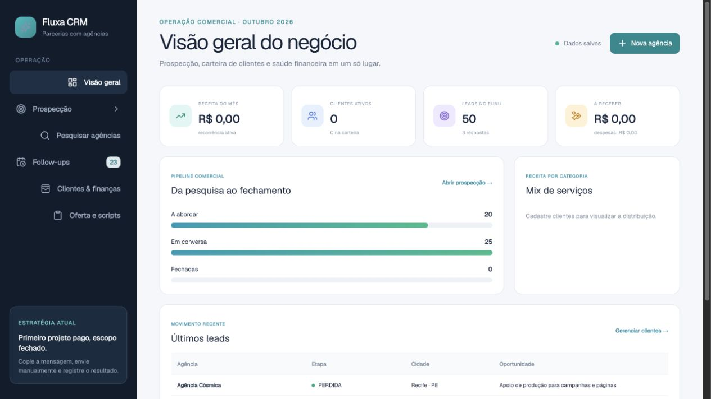

# Fluxa CRM

CRM full-stack criado para organizar prospecção comercial, relacionamento com leads, follow-ups, clientes, serviços e indicadores financeiros em uma única aplicação.

## Visão do produto

O Fluxa transforma uma lista de oportunidades em um processo comercial rastreável. A operação começa pela pesquisa de empresas, passa por abordagem e follow-up e termina no controle dos clientes conquistados e da receita gerada.

### Principais recursos

- Dashboard executivo com receita mensal, clientes ativos, leads e valores a receber
- Funil comercial da pesquisa ao fechamento
- Pesquisa e importação de agências por região
- Fila de prospecção com prioridade, estágio e abordagem personalizada
- Atalhos para WhatsApp e canais públicos de contato
- Follow-ups automáticos por data
- Histórico de eventos e notas por lead
- Cadastro de clientes ativos e inativos
- Múltiplos serviços e mensalidades por cliente
- Controle de despesas, receita histórica e valores a receber
- Interface responsiva para desktop e celular

## Prospecção e relacionamento

Cada oportunidade possui estágio, contexto comercial, canal de contato, mensagem inicial, notas e histórico. O sistema não dispara mensagens de forma não oficial: ele apoia uma abordagem manual, personalizada e auditável.

## Clientes e finanças

O módulo financeiro conecta a execução comercial à carteira conquistada. Cada cliente pode ter vários serviços, categoria, mensalidade, despesas, receita acumulada e saldo pendente.

## Stack

- React 19 e TypeScript
- Vinext e Vite
- Cloudflare Workers e D1
- Drizzle ORM
- Tailwind CSS
- Lucide Icons

## Arquitetura

- `app/`: interface e rotas da aplicação
- `app/api/crm/`: API do CRM
- `lib/`: regras de negócio, prospecção e persistência
- `db/`: schema do banco D1
- `drizzle/`: migrações versionadas

## Sobre o projeto

Projeto de portfólio desenvolvido por **Gabriel Oliveira**. Os nomes e dados exibidos nas capturas são fictícios ou utilizados apenas como demonstração da interface.

> Este repositório é apresentado para fins de portfólio e avaliação técnica.
